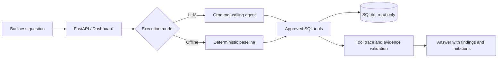

# FulfillGuard — Supply Chain AI Analytics Agent

**LLM-Powered Supply Chain Analytics | Python · SQL · Groq LLM · FastAPI · Docker**

FulfillGuard is a read-only investigation prototype for **historical e-commerce delivery operations**. It lets analysts ask supported delivery-performance questions in natural language, executes allowlisted SQL tools, and attaches auditable evidence to numerical findings. A deterministic, non-LLM baseline is provided for comparison and offline demonstrations.

> **Scope:** FulfillGuard V1 is purpose-built for delivery performance using the Olist Brazilian E-Commerce dataset. It is **not** a general-purpose agent, autonomous SQL generator, or production supply-chain platform. The repository includes the running implementation, synthetic test data generator, tests, and evaluation harness; the original dataset is downloaded separately.

## What it does

- **LLM tool orchestration:** Groq-hosted GPT-OSS 120B selects from five restricted analytical tools (`delivery_kpis`, `compare_periods`, `breakdown`, `inspect_order`, `schema_info`).
- **Delivery investigations:** calculates late-delivery rates, compares historical purchase cohorts, and segments results by customer state, seller state, or purchase month.
- **Evidence controls:** preserves the executed tool trace, validates model-supplied numerical claims against tool-output paths, and withholds narrative fields containing unsupported numbers.
- **SQL safety:** parameterized query values, validated arguments, an allowlist, and SQLite read-only connections. There is no arbitrary SQL execution or write tool.
- **Offline benchmark:** deterministic SQL-based comparator and independent aggregate-oracle evaluation for supported scenarios. The offline baseline does **not** call an LLM.
- **Browser and API:** FastAPI endpoints, lightweight dashboard, Docker packaging, and a reproducible synthetic fixture.

## Architecture



The LLM chooses an approved tool; it **cannot submit SQL statements for execution**. Tool outputs—not the model—provide KPI values. The verifier rejects mismatched numeric claims, but cannot guarantee semantic correctness of every sentence. See [Architecture](docs/ARCHITECTURE.md) and [Evaluation](docs/EVALUATION.md).

## Quick start (offline, no API key)

Requires Python **3.12** and a terminal in the repository root.

```bash
python3.12 -m venv .venv
source .venv/bin/activate
python -m pip install -r requirements.txt
python -m scripts.make_fixture
FG_DB_PATH=data/demo.db uvicorn app.api:app --host 127.0.0.1 --port 8000
```

Open **http://127.0.0.1:8000**, select **Offline baseline (no LLM)**, and try:

> Compare SP late delivery rates between July 2018 and August 2018.

The generated `demo.db` contains only **six synthetic orders**. It is a functional smoke test, not evidence of model performance on real data.

## Run on the historical Olist dataset

The public repository intentionally excludes the original CSV files and generated database. Obtain the [Olist Brazilian E-Commerce dataset on Kaggle](https://www.kaggle.com/datasets/olistbr/brazilian-ecommerce) and place the four required CSV files in `data/raw/` (see `scripts/load_olist.py`), then run:

```bash
python -m scripts.load_olist --source data/raw --dest data/olist.db
FG_DB_PATH=data/olist.db python -m scripts.audit_data
FG_DB_PATH=data/olist.db uvicorn app.api:app --host 127.0.0.1 --port 8000
```

An optional helper can download the dataset using `kagglehub` (`python -m pip install kagglehub` followed by `python -m scripts.fetch_olist`); it may depend on Kaggle authentication or availability. The importer creates a hash and integrity manifest locally.

The development dataset contained **99,441 orders** (purchase dates from 2016-09-04 through 2018-10-17). Hash manifests record imported file contents but do not independently prove the dataset's provenance. See [Case study](docs/CASE_STUDY.md).

## Enable LLM mode (optional)

The agent uses **Groq's OpenAI-compatible API**. An API key is required for live queries; free-tier availability and quotas are controlled by the provider. No paid API is required for the offline baseline.

```bash
export GROQ_API_KEY='YOUR_OWN_GROQ_API_KEY'
export GROQ_MODEL='openai/gpt-oss-120b'
FG_DB_PATH=data/olist.db uvicorn app.api:app --host 127.0.0.1 --port 8000
```

Set the key in your environment or a local `.env` file that is never committed. **Do not paste real keys into source files or Git commands.** For a Docker demo after generating the synthetic fixture:

```bash
FG_DB_FILENAME=demo.db docker compose up --build
```

For a real-data Docker demo, use `FG_DB_FILENAME=olist.db` after importing Olist. Docker Compose reads `GROQ_API_KEY` from the shell environment or local `.env`. The app has **no public-user authentication or rate limiting**: run it locally, not as an internet-facing service.

## API

| Endpoint | Purpose |
|---|---|
| `GET /` | Browser investigation dashboard |
| `GET /health` | Dataset and model-configuration health |
| `POST /investigate` | Execute `llm` or `baseline` investigation |

Example request (after starting the server):

```bash
curl -s http://127.0.0.1:8000/investigate \
  -H 'Content-Type: application/json' \
  -d '{"question":"What share of delivered orders were late in July 2018?","mode":"baseline"}'
```

## Testing and evaluation

```bash
python -m pytest tests/ -q
python -m scripts.make_fixture
FG_DB_PATH=data/demo.db python -m scripts.eval_baseline --output eval/baseline_report.json
```

**Recorded development results:** 43 passing automated tests (Python 3.12, November 2026); the deterministic baseline passed **22/22** supported scenarios on the imported Olist dataset. A separate **28-case live-model evaluation** identified unresolved tool-selection and evidence-grounding weaknesses. Full scores, methodology and observed failures are documented in [Evaluation](docs/EVALUATION.md). These checks do **not** establish production reliability or end-to-end factual answer accuracy.

## Known limitations

- Designed for historical delivery KPIs, not arbitrary questions such as total order volume, revenue, or forecasting. Similar natural-language questions can lead to incorrect routing or incomplete answers.
- The narrative verifier may suppress useful explanations; numeric provenance validation does not fully verify the meaning of a business statement.
- The LLM relies on an external API; provider errors, rate limits, and malformed responses can affect availability.
- Seller-state analysis uses **order–seller pairs**; its counts are not interchangeable with distinct order counts.
- Read-only analytics is not a substitute for production access control, data-governance approvals, comprehensive logging, or confidentiality controls.

## Project documentation

- [Architecture and tradeoffs](docs/ARCHITECTURE.md)
- [Observed evaluation results](docs/EVALUATION.md)
- [Supply-chain case study](docs/CASE_STUDY.md)
- [Security and privacy boundaries](docs/SECURITY.md)

**Data attribution:** [Olist Brazilian E-Commerce Public Dataset](https://www.kaggle.com/datasets/olistbr/brazilian-ecommerce), distributed separately under its applicable Kaggle dataset terms. This repository does not redistribute the dataset.
